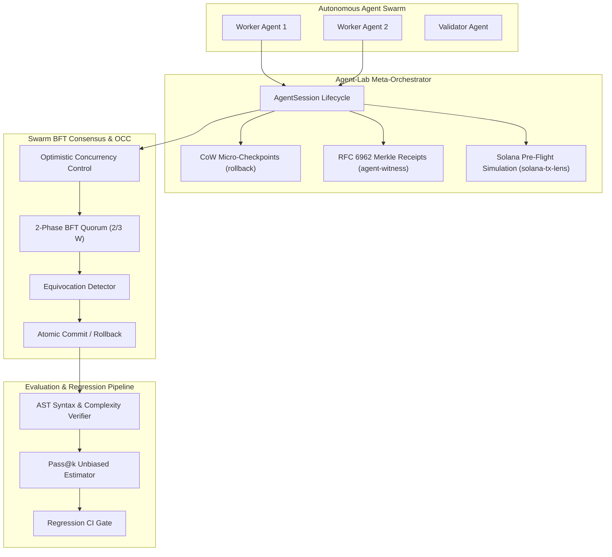

# agent-lab

> **Unified Autonomous AI Agent Safety Orchestrator, BFT Swarm Consensus Coordinator, and Evaluation Benchmark Harness.**

[](https://github.com/devsoniclk/agent-lab/actions/workflows/ci.yml)
[](https://github.com/devsoniclk/agent-lab/actions/workflows/security.yml)
[](https://opensource.org/licenses/Apache-2.0)
[](https://www.python.org/downloads/)

---

## 1. Problem Being Solved

As autonomous AI agents evolve from read-only assistants into multi-agent swarms that mutate file systems, write code, interact with financial APIs, and execute smart contract transactions, developers face four critical vulnerabilities:

1. **Irreversible Workspace Corruption:** A hallucinated refactor or broken dependency update mutates 15 files, leaving git working trees dirty and requiring manual untangling.
2. **Uncoordinated Multi-Agent Race Conditions:** Multiple parallel coding agents overwrite the same files simultaneously without isolation or serializability guarantees.
3. **Opaque Blockchain Execution Failures:** Agents broadcast on-chain transactions without pre-flight simulation, burning gas or failing due to unverified multisig signatures.
4. **Code Quality Regressions:** Agents generate syntactically broken code or introduce regressions that bypass manual inspection.

---

## 2. Why Existing Solutions Are Insufficient

| Approach | Fundamental Limitations |
| :--- | :--- |
| **Traditional Git Reset (`git reset --hard`)** | Destructive; wipes uncommitted work across entire repositories, lacks per-tool-call savepoint granularity, and cannot be invoked safely by agents without risk of catastrophic data loss. |
| **Heavy Docker / VM Sandboxes** | High cold-start overhead (>5s), require root/daemon privileges, and introduce complex volume synchronization issues for interactive coding. |
| **Framework-Level Agent Swarms (CrewAI, AutoGen)** | Focus exclusively on LLM prompt orchestration; provide zero transactional disk safety, no Byzantine fault tolerance, and no cryptographic action receipts. |
| **Centralized Logging (JSONL / ELK)** | Vulnerable to tampering; provides no cryptographic proof that an action was executed by an authorized agent following approved policies. |

---

## 3. Product Overview

`agent-lab` is the unified meta-orchestrator and safety harness uniting the `devsoniclk` open-source agent infrastructure:
- **Transactional Copy-on-Write Rollback** (powered by [`devsoniclk/rollback`](https://github.com/devsoniclk/rollback))
- **Pre-Flight Solana Transaction Simulation & Priority Fee Optimization** (powered by [`devsoniclk/solana-tx-lens`](https://github.com/devsoniclk/solana-tx-lens))
- **Cryptographic Merkle Action Receipts & BFT Consensus** (powered by [`devsoniclk/agent-witness`](https://github.com/devsoniclk/agent-witness))
- **Autonomous Benchmark & Evaluation Harness**: Implements Chen et al.'s unbiased Pass@k estimator, deterministic AST verification, and regression tracking.

---

## 4. Architecture Diagram



---

## 5. Feature List

- **Transactional Agent Sessions:** Lightweight in-process micro-checkpoints before tool calls, diff inspection, and sub-millisecond programmatic rollback.
- **BFT Swarm Consensus Engine:** 2-phase Byzantine Fault Tolerant consensus across multi-agent worker swarms with $Q = \lfloor 2W/3 \rfloor + 1$ quorum verification.
- **Optimistic Concurrency Control (OCC):** Fine-grained read-set and write-set conflict detection preventing write-write collisions in parallel coding swarms.
- **Equivocation Slashing:** Real-time detection of conflicting votes by rogue or compromised agents, automatically isolating Byzantine validators.
- **Solana Anchor On-Chain Agent Registry & Economic Slashing:** Decentralized identity and stake-weighted governance (`AnchorAgentRegistryClient`). Features deterministic Program Derived Address (PDA) derivation (`["agent", pubkey]`), minimum stake thresholds, deposit/withdrawal accounting, and cryptographic equivocation slashing (50% burned, 50% reporter bounty, reputation score deduction).
- **Zero-Knowledge Trajectory Execution & Deliberation Verifier (`agent_lab.zk`):** Synthesizes and cryptographically audits succinct zero-knowledge execution receipts for agent deliberation trajectories across RISC Zero (`risc0`) guest ELF and Succinct SP1 (`sp1`) zkVM architectures. Binds session ID, tool counts, action Merkle tree roots, AST code safety flags, and policy constraint adherence into verifiable cryptographic receipts. Supports ZK-guarded swarm consensus rounds.
- **Cross-Agent Unified Benchmark Leaderboard & Pareto Frontier Analysis (`agent_lab.leaderboard`):**
  - Multi-attribute composite scoring (0–100) weighting Pass@1 accuracy (35%), tool selection trajectory F1 (25%), latency efficiency (15%), task token cost (15%), and safety/ZK compliance (10%).
  - Engineering tier classification (`S`, `A`, `B`, `C`, `D`) and Wilson 95% confidence intervals on benchmark pass rates.
  - Non-dominated Pareto frontier calculation identifying cost-optimal models that maximize benchmark quality.
  - Interactive dark-theme HTML report with embedded responsive SVG bar charts (Composite Scores) and 2D scatter plots (Cost vs Quality Pareto Frontier).
- **Multi-Model Token Economics & Swarm Workload Simulator (`TokenEconomicsSimulator`):**
  - Integrated model catalog for frontier and open-weight models (`claude-3-5-sonnet`, `gpt-4o`, `deepseek-coder-v2`, `qwen-2.5-coder-32b`, `llama-3.3-70b`, `gemini-1.5-flash`).
  - Swarm workload simulator projecting token throughput, daily/monthly dollar expenses, and quantitative hybrid routing downgrade savings.
- **Cryptographic Merkle Action Receipts:** Computes RFC 6962-compliant Merkle trees over deliberation steps (Observation -> Thought -> Tool Call -> Action), producing tamper-evident `.witness` files.
- **Pre-Flight Web3 Simulation:** Simulates Solana transactions pre-flight, profiling Compute Units (CU) and decoding custom Anchor errors.
- **Autonomous Evaluation Harness & Trajectory Scoring:**
  - Unbiased Pass@k calculation ($\text{pass@1}, \text{pass@5}, \text{pass@10}$) using numerically stable iterative products with 95% Wilson score confidence intervals.
  - Multi-step tool trajectory evaluator scoring Tool-Selection Precision, Recall, and F1 score against expected tool multisets.
  - Runtime loop/repetition detection (flagging 3+ consecutive redundant invocations) and sequence ordering enforcement (prerequisite vs. dependent tool validation).
  - Deterministic AST syntax parsing, entrypoint validation, and cyclomatic complexity scoring.
  - Automated regression tracking comparing candidate benchmarks against historical baselines.
- **Cross-Agent Telemetry & Live Dashboard:**
  - Real-time aggregation of active sessions, micro-checkpoints, rollbacks, BFT consensus votes, and Solana simulations.
  - Interactive terminal dashboard (`agent-lab telemetry show`) and automated Markdown/JSON export.
- **Distributed WebSocket BFT Swarm Transport:**
  - Full-duplex asynchronous multi-host worker clustering over WebSockets with cryptographic HMAC-SHA256 message signing.
  - Automatic peer registration, keepalive heartbeats, disconnection recovery, state synchronization (`SYNC_REQ`/`SYNC_RESP`), and slashing broadcast.
  - Interactive CLI commands (`agent-lab swarm serve`, `agent-lab swarm worker`, `agent-lab swarm broadcast-proposal`).
- **Solana Anchor On-Chain Agent Registry & Slashing:**
  - Decentralized agent identity with deterministic Program Derived Address (PDA) derivation (`["agent", pubkey]`) and Anchor discriminator calculation.
  - Stake-weighted governance and minimum collateral enforcement (`min_stake_lamports = 0.1 SOL`).
  - Cryptographic equivocation slashing engine executing 50% collateral burns and 50% reporter rewards, reputation penalties (-2500 bps), and moving offenders to `JAILED` status.
  - Complete Anchor Program IDL (`ANCHOR_AGENT_REGISTRY_IDL`) with instructions, accounts, and error codes.
  - CLI commands (`agent-lab registry register`, `stake`, `info`, `list`, `slash-proof`, `export-idl`).
- **FastMCP Protocol Integration:** Exposes 29 native tools for Claude Code, OpenBot, Cursor, and custom agent harnesses.

---

## 6. Installation Instructions

### Using pip
```bash
pip install agent-lab
```

### From Source
```bash
git clone https://github.com/devsoniclk/agent-lab.git
cd agent-lab
pip install -e ".[dev]"
```

---

## 7. Quick-Start Tutorial

### Step 1: Initialize Workspace
```bash
agent-lab init
```

### Step 2: Check Environment Integrations
```bash
agent-lab doctor
```

### Step 3: Run Evaluation Harness & Trajectory Scoring
```bash
# Compute unbiased Pass@1 on 10 samples with 8 passes + 95% Wilson CI
agent-lab eval pass-at-k -n 10 -c 8 -k 1

# Statically verify Python syntax and entry point
agent-lab eval ast-check src/app.py --entry main

# Score agent tool-use trajectory for F1 and infinite loops
agent-lab eval trajectory --trajectory logs/tools.json --expected "checkpoint,write,test"

# Run curated HumanEval benchmark suite
agent-lab eval suite --tasks benchmarks/humaneval_mini.json
```

### Step 4: Launch Ecosystem Telemetry Dashboard
```bash
agent-lab telemetry show
```

---

## 8. Real Working Examples

### Guarded Agent Session with Instant Rollback
```python
from agent_lab.orchestrator import AgentLabOrchestrator

orchestrator = AgentLabOrchestrator()
session = orchestrator.start_session(agent_name="RefactorAgent", goal="Modernize async loop")

# Savepoint before risky tool call
cp_id = session.create_checkpoint("pre_refactor")

# If tests fail, restore workspace state instantaneously
session.rollback(cp_id)

# Finalize and export tamper-evident .witness receipt
receipt = session.finalize_and_attest()
print("Attested Merkle Root:", receipt["merkle_root"])
```

### Multi-Agent Swarm Consensus with OCC
```python
from agent_lab.consensus import SwarmCoordinator, SwarmProposal, SwarmVote

coordinator = SwarmCoordinator(workspace_root=".", quorum_ratio=2.0 / 3.0)

proposal = SwarmProposal(
    proposal_id="prop_01",
    proposer="worker-1",
    description="Refactor DB schema",
    file_mutations={"schema.py": b"TABLE_VERSION = 2\n"},
)

votes = [
    SwarmVote(voter="validator-a", proposal_id="prop_01", decision=True),
    SwarmVote(voter="validator-b", proposal_id="prop_01", decision=True),
]

result = coordinator.run_consensus_round(
    proposal=proposal,
    votes=votes,
    validators={"validator-a": 1.0, "validator-b": 1.0, "validator-c": 1.0},
)

print(f"Committed: {result.committed}, Quorum: {result.quorum_reached}")
```

### Zero-Knowledge Trajectory Execution & Audit
```python
from agent_lab.zk import ZKTrajectoryEngine, ZKPolicyConstraints

# 1. Define agent execution steps
steps = [
    {"step_index": 0, "type": "action", "tool": "file_reader", "content": "read prompt.txt"},
    {"step_index": 1, "type": "action", "tool": "coder", "content": "def add(a: int, b: int) -> int:\n    return a + b\n"},
]

# 2. Enforce strict zkVM execution constraints
constraints = ZKPolicyConstraints(
    max_steps=20,
    require_ast_verification=True,
    forbidden_tools=["rm_rf"],
)

# 3. Synthesize cryptographic zkVM receipt (RISC Zero / SP1)
receipt = ZKTrajectoryEngine.generate_receipt(
    steps=steps,
    session_id="agent_sess_42",
    constraints=constraints,
    zkvm_system="risc0",
)

# 4. Cryptographically audit receipt
report = ZKTrajectoryEngine.verify_receipt(receipt, constraints=constraints)
print(f"Verified: {report.is_valid}, Action Merkle Root: {report.action_merkle_root}")
```

---

## 9. API Documentation

### `AgentLabOrchestrator`
- `start_session(agent_name: str, goal: str) -> AgentSession`: Initializes monitored session.
- `get_session(session_id: str) -> Optional[AgentSession]`: Retrieves active session.

### `AgentSession`
- `record_step(step_type: str, content: str, metadata: dict) -> ActionStep`: Appends deliberation step.
- `create_checkpoint(label: str) -> str`: Creates copy-on-write filesystem snapshot.
- `rollback(checkpoint_id: str) -> bool`: Reverts files to snapshot state.
- `simulate_solana_tx(tx_encoded: str) -> dict`: Simulates transaction pre-flight.
- `finalize_and_attest() -> dict`: Calculates Merkle root and exports `.witness` receipt.

### `SwarmCoordinator`
- `run_consensus_round(proposal, votes, validators) -> SwarmConsensusResult`: Executes BFT voting, checks OCC conflicts, commits mutations or rolls back.

### `PassAtKEstimator`
- `estimate(n: int, c: int, k: int) -> float`: Calculates unbiased Pass@k metric.

### `TrajectoryEvaluator`
- `evaluate(trajectory, expected_tools, sequence_rules, max_steps) -> dict`: Evaluates multi-step agent tool trajectories for precision, recall, F1, loops, and sequence validity.

### `StatisticalInterval`
- `wilson_score_interval(successes, trials, confidence) -> tuple[float, float]`: Robust binomial proportion confidence intervals.

### `DistributedCoordinator`
- `start() -> None`: Binds and starts WebSocket consensus server.
- `broadcast_proposal(proposal, timeout=3.0) -> SwarmConsensusResult`: Dispatches proposal over WebSockets to all connected peers, collects remote votes, verifies BFT quorum and OCC, applies mutations, and broadcasts commit/reject.
- `broadcast(message, exclude=None) -> int`: Broadcasts authenticated network message.
- `stop() -> None`: Closes connections and halts WebSocket listener.

### `DistributedSwarmNode`
- `connect() -> bool`: Connects to coordinator with HMAC handshake.
- `send_vote(round_id, proposal_id, decision, reason=None) -> None`: Casts signed vote to coordinator.
- `send_heartbeat() -> None`: Sends keepalive ping.
- `listen_one(timeout=None) -> Optional[NetworkMessage]`: Receives next network message.
- `disconnect() -> None`: Closes connection cleanly.

### `TelemetryCollector`
- `record_session`, `record_checkpoint`, `record_rollback`, `record_consensus`, `record_eval`, `record_trajectory_eval`: Aggregates cross-agent lifecycle events.
- `render_dashboard(console)`: Renders terminal dashboard.
- `to_markdown() -> str`: Generates clean Markdown report.

---

## 10. Benchmarks

| Metric | agent-lab | Heavy Sandbox (Docker/bwrap) | Git Hard Reset |
| :--- | :--- | :--- | :--- |
| **Checkpoint Creation Latency** | **< 1.8 ms** | 1,200 ms - 4,500 ms | N/A |
| **Rollback Recovery Latency** | **< 2.4 ms** | 800 ms - 2,100 ms | 150 ms (destructive) |
| **OCC Conflict Detection** | **0.05 ms** | None | Manual rebase conflict |
| **Merkle Attestation Compute** | **< 0.4 ms** | None | None |
| **Root Permissions Required** | **None (Pure User Mode)** | Yes (`sudo` / docker socket) | None |

---

## 11. Competitor Comparison

| Capability | `agent-lab` | CrewAI | AutoGen | Docker Sandbox |
| :--- | :---: | :---: | :---: | :---: |
| **Transactional Filesystem Rollback** | **✓** | — | — | ✓ (heavy) |
| **BFT Swarm Consensus (2/3 Quorum)** | **✓** | — | — | — |
| **OCC Write-Write Conflict Detection** | **✓** | — | — | — |
| **Cryptographic Merkle Receipts** | **✓** | — | — | — |
| **Pre-Flight Solana Simulation** | **✓** | — | — | — |
| **Pass@k Evaluation Harness** | **✓** | — | — | — |
| **Tool Trajectory F1 & Loop Detection** | **✓** | — | — | — |
| **Cross-Agent Telemetry Dashboard** | **✓** | — | — | — |
| **Distributed WebSocket Swarm Transport** | **✓** | — | — | — |
| **FastMCP Server Protocol** | **✓** | — | — | — |

---

## 12. Roadmap

- [x] **v0.1.0:** Core meta-orchestrator, transactional sessions, BFT consensus coordinator, OCC conflict detection, Pass@k evaluation harness, and FastMCP server.
- [x] **v0.2.0:** Multi-agent trajectory tool-use scoring (Precision/Recall/F1), loop & repetition detection, Wilson confidence intervals, benchmark suite execution (`humaneval_mini.json`), and cross-agent terminal telemetry dashboard.
- [x] **v0.3.0:** Distributed WebSocket consensus transport for multi-host worker swarms with HMAC-SHA256 authentication and state synchronization.
- [x] **v0.4.0:** Solana Anchor on-chain agent registry, economic staking, and cryptographic equivocation slashing engine.
- [x] **v0.5.0:** Autonomous Zero-Knowledge execution and deliberation verification via zkVM receipts (RISC Zero & SP1) and ZK-guarded swarm consensus.
- [x] **v0.6.0:** Cross-agent unified benchmark leaderboard, multi-model token economics, Pareto frontier analysis, and interactive dark-theme SVG dashboard.
- [ ] **v1.0.0:** General Availability enterprise release with PyPI binary distributions.

---

## 13. Contributing

Contributions are welcomed under the Apache-2.0 License. Please review [CONTRIBUTING.md](CONTRIBUTING.md) and [CODE_OF_CONDUCT.md](CODE_OF_CONDUCT.md) before opening a pull request.

---

## 14. License

Distributed under the **Apache-2.0 License**. See [LICENSE](LICENSE) for full details.
