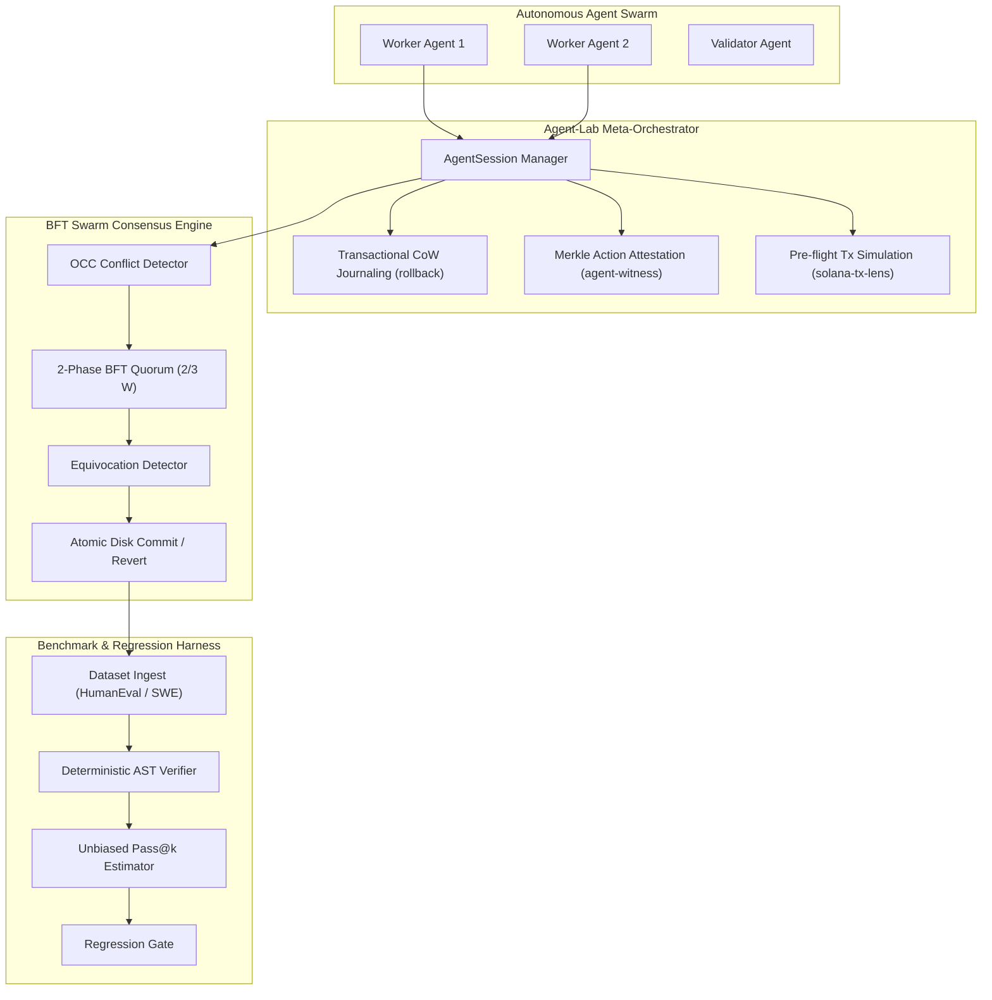

# Architecture & System Design

`agent-lab` provides a unified safety orchestrator, BFT swarm consensus coordinator, and automated code generation benchmark harness for autonomous AI agents.

## Core Subsystems

### 1. Transactional Execution Sandboxing
Guarantees fine-grained workspace micro-checkpoints before tool execution. If code generation or shell commands break existing unit tests, the workspace is atomically restored without leaving dirty working tree artifacts.

### 2. Cryptographic Action Attestation
Every step (Observation -> Thought -> Tool Call -> Tool Result -> Mutation) is hashed into an RFC 6962-compliant Merkle tree, yielding a verifiable `.witness` receipt.

### 3. Pre-flight Web3 Simulation
Intercepts on-chain transactions (Solana) before broadcast, simulating compute units, verifying multisig threshold approvals, and optimizing priority fees against write-lock contention.

### 4. BFT Swarm Consensus & OCC
Coordinates parallel agent workers by enforcing Optimistic Concurrency Control (OCC) across read/write sets. Change proposals are only committed to disk upon reaching a $2/3$ weighted Byzantine quorum; equivocation attempts trigger immediate validator slashing.

### 5. Autonomous Evaluation Harness
Implements Chen et al.'s unbiased Pass@k estimator alongside deterministic AST syntax and cyclomatic complexity auditing to catch code regressions before releases.
